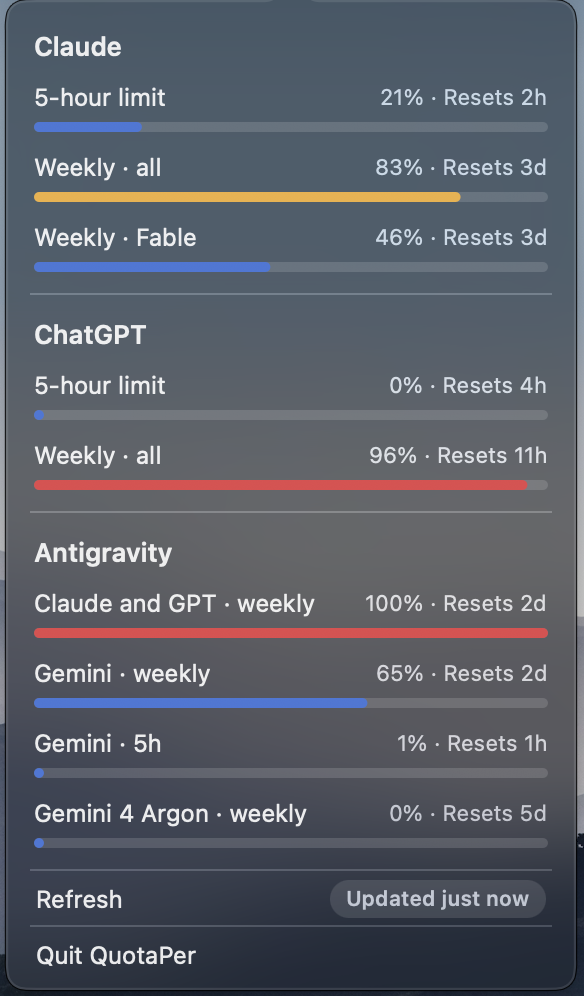

# QuotaPer

A native macOS menu bar app (Swift, AppKit) that shows your remaining AI quota at a glance:

- **Claude** (Claude Code login): 5-hour, 7-day and per-model weekly limits
- **ChatGPT** (Codex login): 5-hour and 7-day limits
- **Antigravity**: per-group quotas. While Antigravity (or Gemini) is open they come from its local server; when it is closed they come from `agy --print /usage --output-format json` (needs the `agy` CLI signed in). The last reading is kept if both fail.

<p align="center"><a href="https://github.com/Abdulazizg1/QuotaPer/releases/download/v1.0.0/QuotaPer-1.0.0.dmg"><b>⬇ Download QuotaPer 1.0.0 (DMG)</b></a><br><sub>macOS 13+ · Apple Silicon and Intel</sub></p>

<p align="center"></p>

The menu bar shows a small gauge ring (filled to your main usage); click it to open the details.
Bars turn amber at 70% and red at 90%.

## Install

1. Download [`QuotaPer-1.0.0.dmg`](https://github.com/Abdulazizg1/QuotaPer/releases/download/v1.0.0/QuotaPer-1.0.0.dmg) (or any version from the [Releases](../../releases) page).
2. Open it and drag **QuotaPer** into **Applications**.
3. The first time, right-click the app and choose **Open** (it is not notarized yet), then **Open** again.
4. Click the ring icon in the menu bar.

## Requirements

- macOS 13+
- You are already signed in to Claude Code and/or Codex / Antigravity. QuotaPer reuses those
  local logins (Keychain item `Claude Code-credentials`, `~/.codex/auth.json`, the Antigravity
  local daemon). It never sends credentials anywhere except to the provider's own usage endpoint.
- The first launch asks for Keychain access to the Claude Code item; choose **Always Allow**.

## Build

```bash
swift build -c release      # development build
bash Scripts/package.sh        # universal QuotaPer.app + .zip + .dmg in dist/
```

> Don't build into a folder that SwiftBar/xbar watches - it will try to run the binary as a plugin.
> Use `OUT=/some/other/dir bash Scripts/package.sh`.

## Publishing

The app **cannot be sandboxed** (it reads other apps' credentials and local files), so distribute it
outside the Mac App Store:

1. Sign with a Developer ID certificate: `SIGN_ID="Developer ID Application: Name (TEAMID)" bash Scripts/package.sh`
2. Notarize: `xcrun notarytool submit dist/QuotaPer-1.0.0.dmg --keychain-profile <profile> --wait`
3. Staple: `xcrun stapler staple dist/QuotaPer-1.0.0.dmg`.
4. Upload the dmg to a GitHub Release (and optionally add a Homebrew cask).

Without a Developer ID the build is ad-hoc signed, so users must right-click the app -> **Open** the first time.

## Notes

- Cloud endpoints are rate limited; QuotaPer refreshes every minute and
  backs off automatically on HTTP 429. These are undocumented endpoints and may change.
